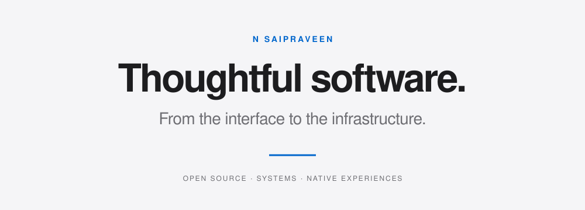
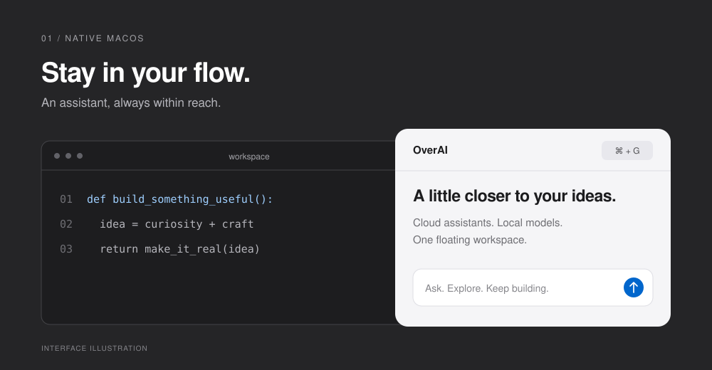
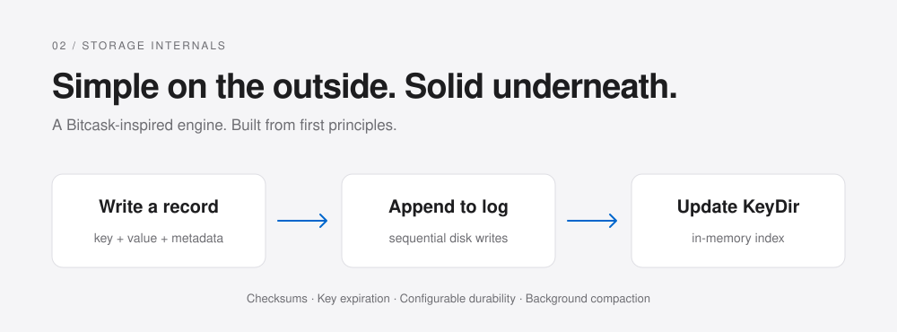

  

  Open-source developer from India. 
  Building across macOS, developer tools, storage systems, and the cloud.

  <a href="#selected-work">Selected work</a> &nbsp; · &nbsp;
  <a href="https://www.linkedin.com/in/sai-praveen-26b186253/">LinkedIn</a> &nbsp; · &nbsp;
  <a href="mailto:n.sai.praveen.2004@gmail.com">Get in touch</a>

 

## Selected work

### OverAI
**Your AI. One shortcut away.**

A floating macOS workspace for cloud assistants and local models. Built with Python and PyObjC, using AppKit and WebKit to bring AI into the desktop workflow.

`Python` &nbsp; `PyObjC` &nbsp; `AppKit` &nbsp; `WebKit` &nbsp; `Ollama`

[Explore OverAI →](https://github.com/N-Saipraveen/overai-mac) &nbsp;&nbsp; [Releases →](https://github.com/N-Saipraveen/overai-mac/releases)

 

### LagerKV
**Small engine. Deep systems thinking.**

A key-value storage engine built from scratch in Go, inspired by Bitcask. Append-only logs meet an in-memory index, with CRC32 checksums, key expiration, configurable fsync, and background compaction.

`Go` &nbsp; `Storage engines` &nbsp; `Concurrency` &nbsp; `Data integrity`

[Explore LagerKV →](https://github.com/N-Saipraveen/LagerKV) &nbsp;&nbsp; [Interactive demo →](https://N-Saipraveen.github.io/LagerKV/)

 

## What I bring to the build

| Area | Toolkit & interests |
| :--- | :--- |
| **Systems** | Go, C, data structures, storage internals |
| **Applications** | Python, Java, native macOS integrations |
| **Infrastructure** | Linux, Git, DevOps, cloud workflows |
| **Open source** | Building in public, sharing code, learning through implementation |

I like understanding how things work beneath the surface—and turning that understanding into something useful. My projects move between the experience on screen and the systems that make it possible.

 

## Let's build something useful.

Interested in developer tools, native experiences, or infrastructure? I'd love to connect.

[Email →](mailto:n.sai.praveen.2004@gmail.com) &nbsp;&nbsp; [LinkedIn →](https://www.linkedin.com/in/sai-praveen-26b186253/) &nbsp;&nbsp; [X →](https://twitter.com/n_saipraveen)

---

N Saipraveen &nbsp; · &nbsp; India &nbsp; · &nbsp; Built with intention. Shared openly.

